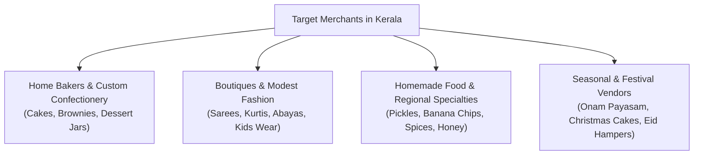
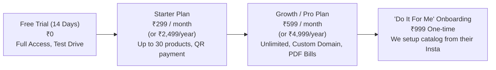

# Kerala WhatsApp Commerce Platform: Business Strategy & Go-To-Market Plan

---

## 1. The "Anyone Can Build This with ChatGPT" Reality Check

You identified the core dilemma: **The code is not the moat.** Anyone can prompt Claude or ChatGPT to spin up a Next.js/Tailwind e-commerce template.

### Why Merchants Will Still Buy From You
1. **The Technical Barrier is Emotional, Not Logical**: A home baker in Thrissur or an abaya seller in Malappuram doesn't know what GitHub, Vercel, Supabase, DNS, SSL, or API webhooks are. Even if they know ChatGPT exists, deploying and maintaining software gives them anxiety.
2. **Setup Friction**: They don't want a "project"; they want orders. If setup takes more than 10 minutes on a smartphone, they abandon it.
3. **Trust & Local Support ("Aalundu" factor)**: In Kerala, local trust rules commerce. Having someone who speaks Malayalam on WhatsApp to help when something breaks beats any Silicon Valley SaaS tool.
4. **Maintenance & Updates**: When WhatsApp updates link formats, or UPI deep-links break on iOS, an independent merchant has no idea how to debug code.

> [!IMPORTANT]
> **Your Core Value Proposition**: You are not selling software; you are selling **peace of mind, time saved from answering repetitive DMs, and zero commission on their sales**.

---

## 2. Target Customer Segments in Kerala

Kerala has one of the highest densities of Instagram and home-based micro-businesses in India. Here are the 4 primary customer tiers:

### Segment Breakdown

| Customer Segment | Typical Locations | Major Pain Points | Willingness to Pay |
| :--- | :--- | :--- | :--- |
| **Home Bakers & Custom Cakes** | Kochi, Calicut, Trivandrum, Kottayam, Thrissur | Daily custom inquiries, date blocking, flavor choices, 50 WhatsApp voice notes per order. | **High** (High margin products, ₹800–₹2,500 per order) |
| **Boutiques & Saree/Abaya Sellers** | Malappuram, Kozhikode, Kannur, Ernakulam | "Price please" DMs, size inquiries, inventory confusion, buyers sending blurry screenshots. | **Very High** (Losing real sales due to delayed DM replies) |
| **Homemade Food / Pickles / Spices** | Alappuzha, Kottayam, Idukki, Wayanad | Managing addresses, calculating postal/courier charges manually, tracking payments. | **Medium** (Volume-driven, price-sensitive) |
| **Custom Gifts & Resin / Craft Artists** | State-wide (mostly college students & young women) | High DM volume, back-and-forth customization details, payment verification. | **Medium to Low** (Smaller budgets, need low-cost entry) |

---

## 3. Pricing Strategy: What Kerala Merchants Will Actually Pay

In Kerala, charging ₹2,500/month (like Shopify) will kill your conversion immediately. Small home-run businesses operate on tight monthly budgets. However, they easily spend ₹300–₹500 on courier charges or mobile recharges without blinking.

### Recommended Pricing Tiers

### Plan Details

1. **Starter Plan (The Sweet Spot)**:
   - **Price**: ₹299 / month (or ₹2,499 / year paid upfront — ~₹208/mo).
   - **Limits**: Up to 30 products, standard subdomain (`storename.yourdomain.com`), direct WhatsApp checkout, UPI QR code.
   - **Target**: Home bakers, pickle sellers, hobbyists with 5–20 active items.

2. **Growth Plan**:
   - **Price**: ₹599 / month (or ₹4,999 / year paid upfront).
   - **Features**: Unlimited products, custom domain mapping (`storename.com`), order tracking dashboard, printable packaging slips / invoices, multi-admin WhatsApp alert.
   - **Target**: Established Instagram boutiques (10k+ followers), busy clothing brands.

3. **The Kerala Secret Weapon: "Managed Onboarding Service" (₹999 One-Time)**
   - Many merchants in Kerala are intimidated by even simple forms.
   - **Offer**: *"Send us your Instagram page or photos on WhatsApp; our team will build and launch your store in 24 hours for ₹999 (includes 1 month free)."*
   - This single hook can drive 60%+ of your initial paid conversions.

---

## 4. Product Experience & Technical Architecture

To beat competitors like Dukaan or complex e-commerce builders, your product must be hyper-tailored to the WhatsApp + UPI ecosystem in India.

### Buyer Experience (Zero Friction)
1. Customer clicks link in Instagram bio or WhatsApp status (`shop.brandname.in`).
2. Fast, app-like mobile catalog (loads under 1 second on Jio/Airtel).
3. Adds items to cart (options for weight: 250g/500g/1kg, or size: S/M/L).
4. Enters Name, Mobile Number, Delivery Address, Pincode.
5. Chooses Payment: **Instant UPI** or **Pay on Confirmation**.
6. Clicks **"Confirm via WhatsApp"**:
   - Webpage triggers `https://wa.me/91XXXXXXXXXX?text=...` with a structured, pre-formatted order summary.
   - If UPI was selected, generates dynamic/static UPI QR code with merchant UPI ID (`upi://pay?pa=...&am=...&tn=Order-102`).

### Merchant Experience (Admin)
- Mobile-optimized web portal (Add to Home Screen PWA).
- Single-tap actions:
  - Add product (Snap photo from phone, title, price, in-stock toggle).
  - Out of stock / In stock switch.
  - Set Delivery Fee rules (e.g., Flat ₹50 within Kerala, ₹100 outside Kerala, Free above ₹1,000).
  - Download single-click shipping label / address slip ready to paste on courier boxes.

---

## 5. Go-To-Market (GTM) Playbook for Kerala

### The "Personalized Demo" Infiltration Method (Highest Conversion)
Don't run broad Facebook ads initially. Use this outbound strategy:

1. **Find Candidates**: Browse Instagram for Kerala home bakers, pickle makers, and boutiques with 2,000 to 25,000 followers.
2. **Pre-build their store**: Spend 3 minutes taking 4 photos and prices from their public Instagram feed and create `thecrumbcraft.yourbrand.in`.
3. **Send a friendly WhatsApp / Instagram DM**:
   > *"Namaskaram Chechi/Bro! We love your page @TheCrumbCraft. We noticed you handle all orders manually over DMs. We set up a quick 1-click WhatsApp catalog for your page so your customers can order directly with UPI: [link]. No login required. Try placing a test order! If you like it, it's 100% free to try for 14 days."*
4. **Result**: The merchant sees their own products already live. It feels magical, requires zero effort on their part, and creates instant goodwill.

### Additional Growth Channels in Kerala
- **Micro-Influencer Collabs**: Target popular Kerala food vloggers and lifestyle creators. Sponsor a 30-second shoutout: *"How my favorite home-baker automated her orders."*
- **Local Flea Markets & Exhibitions**:
  - Events at Lulu Mall (Kochi/Trivandrum/Kozhikode), Calicut Beach events, flea markets like *Kochi Flea Market*, Sunday markets.
  - Set up a small kiosk: "Get your business online in 5 minutes".
- **Malayalam Reel Strategy**:
  - Post short, relatable Reels on Instagram:
    - *"Still replying 'DM for price' in 2026?"*
    - *"How this Calicut boutique stopped losing orders at 11 PM."*
    - Demonstration of the buyer clicking the link, selecting a saree, and paying in 30 seconds.

---

## 6. Financial Projections & Unit Economics

### Cost to Run the Platform (Tech Stack)
- **Frontend / Hosting**: Next.js / Vite hosted on Vercel or Cloudflare Pages (Free / $20 Pro plan).
- **Database & Auth**: Supabase or Neon PostgreSQL (Free tier handles first 50–100 stores easily).
- **Image Storage**: Cloudflare R2 (almost zero cost, free egress).
- **Domain & SSL**: Standard `.in` domain costs ~₹500/year.
- **Estimated Monthly Server Cost**: Under ₹2,500 ($30) for the first 200 stores.

### Revenue Projections

| Month | Active Paid Stores | Monthly Recurring Revenue (MRR) | Setup Fee Revenue (One-time) | Total Est. Revenue |
| :--- | :--- | :--- | :--- | :--- |
| **Month 1-2** | 20 (Early adopters) | ₹6,000 | ₹10,000 | **₹16,000** |
| **Month 3-4** | 75 | ₹22,500 | ₹25,000 | **₹47,500** |
| **Month 6** | 200 | ₹60,000 | ₹40,000 | **₹1,00,000** |
| **Month 12** | 600 | ₹1,80,000 | ₹80,000 | **₹2,60,000 / mo** |

*Assumes average subscription of ₹300/mo and 40% of new merchants taking the ₹999 onboarding package.*

---

## 7. Key Pitfalls & How to Avoid Them

1. **UPI Payment Verification Fraud**:
   - In manual UPI QR flows, some buyers send fake screenshot apps.
   - *Fix*: Provide a built-in guide/template advising merchants to check SMS / bank app credit before dispatching, or integrate cashfree/razorpay UPI dynamic auto-verify as a premium upgrade.
2. **Feature Creep**:
   - Don't build courier API integrations, automated inventory sync, or complicated CRM in V1. Keep it as pure: **Catalog + Cart + Address Form + WhatsApp/UPI handoff**.
3. **Churn Due to Inactive Sellers**:
   - Micro-sellers often start and quit within 3 months. Focus your marketing on sellers who have been posting consistently for at least 6 months.
